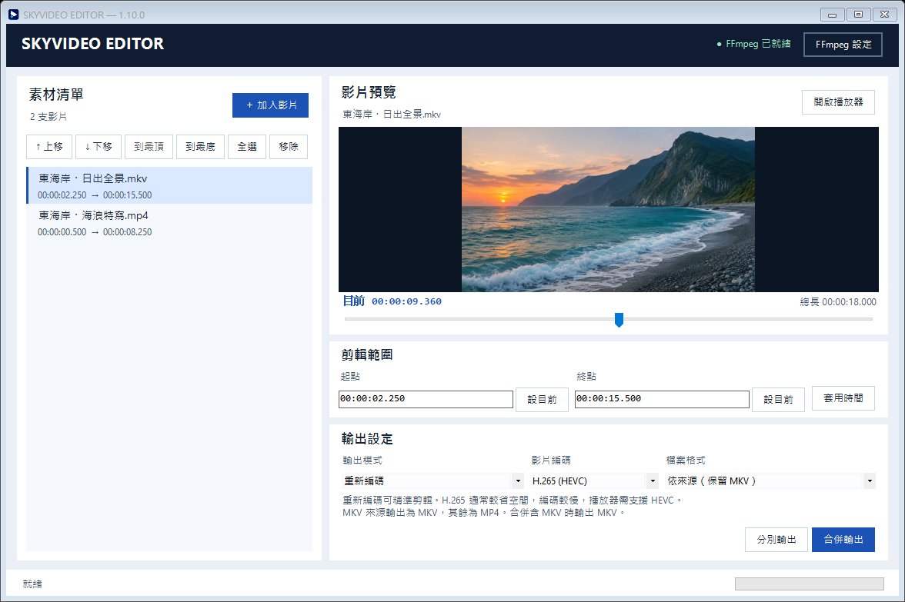

# SKYVIDEO EDITOR



完全離線的 Windows 桌面影片剪輯與合成工具。影片只在本機處理，不需要瀏覽器、localhost 或網路服務。

## 功能

- 素材清單會顯示影片數量及每支影片的剪輯起訖，預覽區會顯示當前時間與影片總長。

- 一次加入多支影片，也可直接拖曳到程式視窗。
- 支援 MP4、MOV、MKV、WebM、AVI、M4V、WMV、FLV、MPEG、MPG、TS、MTS、M2TS。
- 逐筆預覽、拖曳排序、移除片段、設定起點／終點。
- 支援 Ctrl＋滑鼠左鍵選取不連續的多筆影片，以及 Shift 範圍選取。
- 清單有焦點時，Delete 移除所有選取項目；Ctrl+A 或「全選」按鈕選取全部。
- 「上移」「下移」「移到最頂」「移到最底」或拖曳可一次搬移多筆選取項目，保留原本的相對順序。
- 時間軸整條區域都可點選定位、按住拖曳預覽，不必精準抓住游標；不會改動剪輯起點／終點。
- 「分別輸出」為每支影片各存一個檔案。「合併輸出」依清單順序存成單一檔案。
- 批次讀取、剪輯與合成會顯示完成進度。

## 輸出設定

- **重新編碼**依選取的起點與終點剪輯。預設 H.264，播放相容性較廣。H.265（HEVC）通常較省空間，編碼較慢，播放器需支援 HEVC。來源有音訊時，重新編碼會輸出 AAC。
- **快速無損**直接複製第一條影片和第一條音訊串流，保留其原始編碼，並停用編碼選擇。切點可能落在附近的關鍵影格。合併需要相容的影音串流，且目標格式必須支援其編碼。
- **依來源（保留 MKV）**是預設檔案格式。分別輸出時，MKV 來源輸出為 MKV，其餘為 MP4。合併清單只要含有 MKV 就輸出 MKV。也可明確指定 MP4 或 MKV。
- 重新編碼合併時，以第一段的尺寸和影格率為準。其他片段按比例縮放並在需要時補黑邊。

## 從原始碼建置

需要 Windows 內建的 .NET Framework C# 編譯器（通常隨 Windows 提供），不需要 NuGet。

```powershell
.\build_native.ps1
```

輸出檔案為 `dist\SKYVIDEO_EDITOR.exe`。也可以雙擊 `build_native.bat` 建置。

## 1.8.2 更新

- 新增「移到最頂」「移到最底」，支援單選、多選，保留相對順序、目前預覽影片與時間位置，並將清單捲到移動位置。
- 無選取項目、已位於對應端點，或正在讀取／輸出時，停用對應的新排序按鈕。
- 時間軸任意位置點擊直接定位，按住即可拖曳；滑鼠拖出邊界仍可定位至開頭／結尾，放開或失去滑鼠擷取即結束拖曳。
- 保留鍵盤調整、既有預覽延遲與過期影格保護。拖曳只改預覽位置，起點／終點仍由「設為目前」或輸入時間決定。
- 版本更新為 1.8.2，保留既有 v1.8.1 發行檔。

## 1.8 修正

- 「設為目前」按鈕依文字寬度自動調整，「套用時間」所在列依按鈕高度調整，避免裁切。
- 起點／終點標籤、時間欄位及控制列使用自動排版；最小面板寬度依 DPI 調整。
- 設定 End 或套用時間會保留目前預覽位置，不再跳回 Start；更新清單文字也保留多選和捲動位置。
- 支援鍵盤移除、多選、全選及批次排序；移除最後一筆會清空時間欄位和預覽。
- 讀取或輸出期間禁止移除、排序和變更時間，避免改動處理中的清單。

「移除」只移除程式清單項目，原始影片檔案會保留。多選用於移除和排序；右側 Start／End 編輯目前預覽的單一影片，輸出仍處理完整清單。

## 驗證

```powershell
.\test_native.ps1
# 也可加入真實影片與 FFmpeg 預覽測試：
.\test_native.ps1 -FfmpegPath 'D:\YourFolder\ffmpeg.exe' -VideoPath 'D:\YourFolder\test.mp4'
```

目前附帶的回歸測試涵蓋單選／多選移到最頂與最底、選取與預覽位置保持、忙碌狀態保護，以及不同控制項寬度下的原生時間軸幾何、點擊、拖曳、邊界、擷取釋放與鍵盤操作。另可指定 FFmpeg 與影片測試真實影格預覽、確認剪輯起訖時間不變，並在 `work\` 產生測試畫面。不同寬度測試不等於跨螢幕 DPI 實測。

## FFmpeg

原始碼包不包含大型第三方 `ffmpeg.exe`。請從 [FFmpeg 官方網站](https://ffmpeg.org/download.html) 取得 Windows 版本，放到 EXE 同一資料夾，或在程式內按「FFmpeg 設定」選擇它。FFmpeg 依其自身授權條款發佈。

## 直接使用 Release

從 [最新 Release](https://github.com/skypray73/SKYVIDEO-EDITOR/releases/latest) 下載 Portable ZIP 並完整解壓縮後，執行 `SKYVIDEO_EDITOR.exe`。也可把單檔 EXE 放入已有 `ffmpeg.exe` 的程式資料夾。

v1.9.0 的 Portable 建置使用 Gyan.dev FFmpeg 9.0.2，內含支援 H.264 和 H.265 編碼的 `ffmpeg.exe`、`ffprobe.exe`、GPLv3 授權及來源資訊。

## 授權

本專案採 MIT License。FFmpeg 是獨立的第三方元件。

## 重建 Portable ZIP（外部 FFmpeg）

主程式保持小型原生 EXE，FFmpeg 不會嵌入主程式。將已取得的 FFmpeg 發行檔、可選的 ffprobe／DLL、授權和來源說明放在同一個資料夾，再執行：

```powershell
.\build_portable.ps1 -FfmpegDirectory 'D:\FFmpeg-distribution'
```

產生 `dist\SKYVIDEO_EDITOR-Portable.zip` 和 `.zip.sha256`。請完整解壓縮後執行，保留主程式旁的 FFmpeg 與相關檔案。打包流程會保留第三方原始授權文件；本程式文件以 `SKYVIDEO_EDITOR-` 前綴另存。
